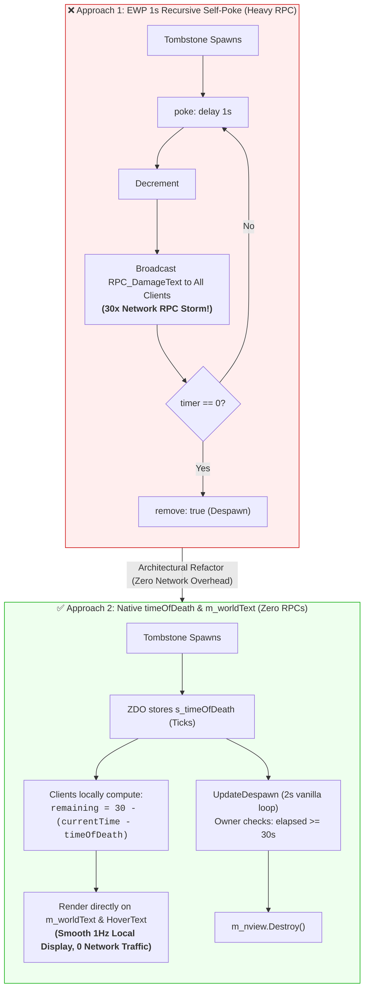

# FAQ-002: How to Implement a Tombstone Despawn Countdown Timer Without RPC Spam (EWP vs. timeOfDeath)

> 📍 **Navigation**: [← Back to README Table of Contents](../../README.md#technical-faq--knowledgebase) | [Knowledgebase Hub](../FAQ.md)

---


| Metadata | Specification |
| :--- | :--- |
| **Category** | Prefab Lifecycle & Server Networking |
| **Target Mods** | **Expand World Prefabs (EWP)** / JereKuusela, World Edit Commands |
| **Engine / Game** | Valheim 1.0 (Deep North) + BepInEx 5.4.2202 |
| **Complexity** | Medium (EWP Tag Evaluation + ZDO `timeOfDeath` + RPC Optimization) |
| **Status** | Verified & Validated |

#### 💬 Context & Inquiry

A community discussion in the modding Discord explored how to create a 30-second floating countdown over player tombstones during server events, culminating in tombstone removal:

> **Pendalf:**  
> *"Is it possible to create a timer above a player's grave that displays numbers floating over the tombstone? ... The idea is this: a tombstone appears and triggers a self-referencing hook with a 30-second timer; it repeats this 30 times, decrementing the displayed number by 1 each time, and the timer's completion coincides with another hook that removes the tombstone at that exact moment."*  
> 
> **Raaka [VWE]:**  
> *"damagetext but then server is spamming the rpcs every sec to change timer too :/ so not rly ideal either... hmm theres the timeOfDeath field in the tombstone tho... like im pondering if we could ride on something that doesnt require us to keep sending stuff through ewp constantly"*  
> 
> **Pendalf:**  
> *"That's cool—but what about the other way around, from 30 to 0? Do you just need to change the formula and the end point? `<sub_1_<int_timer=30>>` ?"*  
> 
> **DhakhaR [VWE]:**  
> `data: int, timer, <sub_<int_timer=30>_1>`

---

#### ⚡ TL;DR Verdict

1. **The Pure EWP YAML Answer**:  
   Yes, counting down from 30 to 0 in EWP is achievable using `data: int, timer, <sub_<int_timer>_1>`, provided `timer` is explicitly initialized to `30` on `type: create`.
2. **The Networking Bottleneck**:  
   As **Raaka** correctly identified, recursive 1-second self-pokes broadcasting `RPC_DamageText` produce **30 network RPCs per dead player**. In an event with multiple casualties, this floods the network buffer, creates floating number drift, and risks desynchronizing on sector unloads.
3. **The Zero-RPC Architectural Solution (`timeOfDeath`)**:  
   Valheim's native `TombStone` component already persistently stores the death timestamp in its ZDO: `ZDOVars.s_timeOfDeath` (`ZNet.instance.GetTime().Ticks`). Furthermore, `TombStone` already possesses a native 3D floating TextMeshPro component: `m_worldText`.  
   Clients can compute and render the remaining countdown locally **with zero RPCs and zero server network traffic**, while the server/owner cleans up the tombstone once `elapsed >= 30.0s`.

---

#### 🔬 Root Cause Engineering Analysis

##### 1. Why the EWP Self-Poke DamageText Pattern Degrades Server Health
In Expand World Prefabs, looping `poke` actions with `delay: 1` execute on the server or owning client:
- Each second, `clientRpc: RPC_DamageText` is dispatched via `ZRoutedRpc.InvokeRoutedRPC(ZRoutedRpc.Everybody, ...)`.
- With 10 dead players during an active event, this generates **600 RPC calls per minute** solely for floating combat text.
- Visually, `DamageText` instances float upward and fade over 1.5 seconds. Firing one every second creates a trailing stack of drifting numbers rather than a stationary countdown over the grave.

##### 2. The Native Engine State in `TombStone.cs`
Decompiling `TombStone` in `assembly_valheim.dll`:
```csharp
// Source: assembly_valheim.dll -> TombStone.Awake()
private void Awake()
{
    m_nview = GetComponent<ZNetView>();
    m_container = GetComponent<Container>();
    ...
    if (m_nview.IsOwner() && m_nview.GetZDO().GetLong(ZDOVars.s_timeOfDeath, 0L) == 0L)
    {
        m_nview.GetZDO().Set(ZDOVars.s_timeOfDeath, ZNet.instance.GetTime().Ticks);
        m_nview.GetZDO().Set(ZDOVars.s_spawnPoint, base.transform.position);
    }
    InvokeRepeating("UpdateDespawn", m_updateDt, m_updateDt); // m_updateDt = 2f
}
```
Two critical architectural facts:
1. **Timestamp Exists**: The exact moment of death is stored persistently in the tombstone's ZDO as an `Int64` tick count (`ZDOVars.s_timeOfDeath`).
2. **In-World 3D Text Exists**: `public TMP_Text m_worldText` is attached directly above the tombstone prefab. In vanilla, it renders the character name in 3D space (`m_worldText.text = ownerName`).
3. **Periodic Heartbeat Exists**: `UpdateDespawn()` already runs every 2 seconds on the owner.

---

#### 📊 Architectural Data Flow



---

#### 🛠️ Workable Solutions

### Solution A: Working Expand World Prefabs YAML (Zero Code)

To count down properly from 30 to 0 in pure EWP without syntax errors or skipping the first number:

```yaml
# 1. On creation: initialize timer to 30 and begin the self-poke loop
- prefab: Player_tombstone
  type: create
  data: int, timer, 30
  poke:
  - self: true
    parameter: timer

# 2. On poke: broadcast DamageText, decrement timer, and re-poke if timer > 0
- prefab: Player_tombstone
  type: poke, timer
  bannedFilter: int, timer, 0
  clientRpc:
  - name: RPC_DamageText
    packaged: true
    1: enum_damagetext, 7
    2: vec, <pos_y+1.5>
    3: string, "<int_timer>s"
    4: bool, true
  data: int, timer, <sub_<int_timer>_1>
  poke:
  - self: true
    parameter: timer
    delay: 1

# 3. On terminal state (timer reaches 0): trigger removal and spawn cleanup VFX
- prefab: Player_tombstone
  type: poke, timer
  filter: int, timer, 0
  remove: true
  spawn:
  - prefab: vfx_spawn_small
```

---

### Solution B: The Native Zero-RPC C# Harmony Extension (Recommended)

This 25-line patch eliminates 100% of RPC traffic. Clients render the countdown smoothly in real time on both the in-world 3D label (`m_worldText`) and the hover tooltip, while the server/owner cleans up the tombstone after 30 seconds:

```csharp
using System;
using HarmonyLib;
using UnityEngine;

[HarmonyPatch(typeof(TombStone))]
public static class TombstoneTimerPatch
{
    public const double DespawnDurationSeconds = 30.0;

    // 1. Client-Side 3D World Text & HoverText (Calculated locally from timeOfDeath, 0 RPCs)
    [HarmonyPostfix]
    [HarmonyPatch(nameof(TombStone.GetHoverText))]
    public static void GetHoverTextPostfix(TombStone __instance, ref string __result)
    {
        if (!__instance.m_nview.IsValid()) return;

        long deathTicks = __instance.m_nview.GetZDO().GetLong(ZDOVars.s_timeOfDeath, 0L);
        if (deathTicks <= 0L) return;

        double elapsed = (ZNet.instance.GetTime().Ticks - deathTicks) / (double)TimeSpan.TicksPerSecond;
        int remaining = Mathf.Max(0, (int)(DespawnDurationSeconds - elapsed));

        // Append to on-screen hover tooltip
        __result += $"\n<color=#FFD700>⏳ Despawns in: {remaining}s</color>";

        // Update the floating 3D text rendered above the tombstone
        if (__instance.m_worldText != null)
        {
            __instance.m_worldText.text = $"{__instance.GetOwnerName()} <color=#FFD700>[{remaining}s]</color>";
        }
    }

    // 2. Server/Owner Despawn Check (Reuses vanilla 2-second heartbeat loop)
    [HarmonyPostfix]
    [HarmonyPatch("UpdateDespawn")]
    public static void UpdateDespawnPostfix(TombStone __instance)
    {
        if (!__instance.m_nview.IsValid() || !__instance.m_nview.IsOwner()) return;

        long deathTicks = __instance.m_nview.GetZDO().GetLong(ZDOVars.s_timeOfDeath, 0L);
        if (deathTicks <= 0L) return;

        double elapsed = (ZNet.instance.GetTime().Ticks - deathTicks) / (double)TimeSpan.TicksPerSecond;
        if (elapsed >= DespawnDurationSeconds)
        {
            __instance.m_removeEffect.Create(__instance.transform.position, __instance.transform.rotation);
            __instance.m_nview.Destroy();
        }
    }
}
```

---

#### 🔭 Observability & Diagnostics

##### Step 1: Inspect Tombstone ZDO Variables Live
To verify `timeOfDeath` on any active tombstone via the `c:\work\deepnorthtesting` Inspector CLI or in-game console:
```powershell
# Query ZDO fields for active tombstones
$tombstoneZDOs = ZDOMan.instance.m_objectsByID.Values | Where-Object { $_.GetPrefab() -eq "Player_tombstone".GetStableHashCode() }
$tombstoneZDOs | ForEach-Object {
    [PSCustomObject]@{
        OwnerName   = $_.GetString(ZDOVars.s_ownerName)
        TimeOfDeath = $_.GetLong(ZDOVars.s_timeOfDeath)
        ElapsedSec  = [math]::Round(((Get-Date).Ticks - $_.GetLong(ZDOVars.s_timeOfDeath)) / 10000000, 1)
    }
}
```

---

*End of FAQ-002. For contributions and additions, see the [FAQ Contribution Standard](../FAQ.md#faq-contribution-standard--entry-template).*

> 📍 **Navigation**: [← Back to README Table of Contents](../../README.md#technical-faq--knowledgebase) | [Browse All FAQs in Hub](../FAQ.md)
