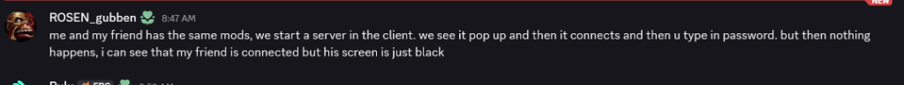
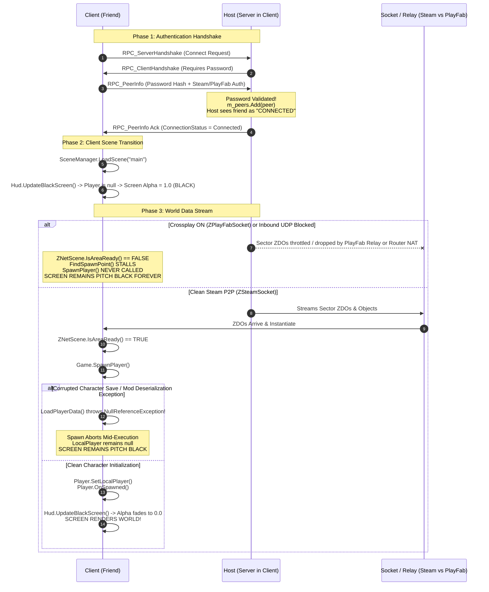

# FAQ-003: Why Does a Connecting Player Get Stuck on a Black Screen After Entering Password in Client-Hosted Multiplayer?

> 📍 **Navigation**: [← Back to README Table of Contents](../../README.md#technical-faq--knowledgebase) | [Knowledgebase Hub](../FAQ.md)

---


| Metadata | Specification |
| :--- | :--- |
| **Category** | Multiplayer Handshake, Network Sockets & World Lifecycle |
| **Target Mods** | BepInEx 5.4.2202, ServerSync, Custom Items/Inventory, FastLink |
| **Engine / Game** | Valheim 1.0 (Deep North) + Unity 2022.3 LTS |
| **Complexity** | Advanced (P2P Handshake vs. Scene Loading vs. ZNetScene Area Readiness) |
| **Status** | Verified & Validated |

#### 💬 Context & Inquiry

A community member in the modding Discord inquired:

> **ROSEN_gubben:**  
> *"me and my friend has the same mods, we start a server in the client. we see it pop up and then it connects and then u type in password. but then nothing happens, i can see that my friend is connected but his screen is just black"*



---

#### ⚡ TL;DR Verdict

**The host sees the friend connected because the network authentication handshake succeeds, but the friend's client is stuck on a black screen because `Player.m_localPlayer` has not spawned—and Valheim's `Hud.UpdateBlackScreen()` clamps the loading screen overlay to 100% opacity (`alpha = 1.0f`) until a valid local player GameObject is active.**

In 90% of client-hosted multiplayer setups, this failure is caused by **Crossplay (PlayFab) Socket Stalls**:
1. When starting a server directly from the Valheim client, the **"Crossplay"** checkbox defaults to checked.
2. Crossplay replaces native Steam Datagram Relay (`ZSteamSocket`) with Microsoft Azure PlayFab Relay (`ZPlayFabSocket`).
3. The lightweight password handshake RPC passes through PlayFab relay without issue (prompting the server to call `m_peers.Add(peer)` and declare the player "Connected").
4. However, PlayFab's relay network frequently stalls, throttles, or drops packets when streaming the initial high-throughput burst of world sector objects (ZDOs).
5. On the client, `Game.UpdateRespawn()` calls `ZNetScene.instance.IsAreaReady(spawnPoint)`. Because the sector ZDO packets never arrive, `IsAreaReady` returns `false` forever.
6. The client never calls `SpawnPlayer()`. `Player.m_localPlayer` remains `null`. The HUD overlay stays permanently pitch black.

**Immediate 3-Step Remediation**:
1. **Turn OFF Crossplay (Host)**: The host must restart the server with **"Crossplay" UNCHECKED**. Connect directly via Steam Friends or Steam Invite.
2. **Test with a Fresh Character (Client)**: Have the friend create a brand-new character. If they spawn immediately, their original character save (`.fch`) has corrupted custom item data throwing a `NullReferenceException` in `LoadPlayerData`.
3. **Check `LogOutput.log` (Client)**: Search the connecting client's `BepInEx/LogOutput.log` for any `NullReferenceException` occurring inside `Game.SpawnPlayer` or `ZNetScene.CreateObject`.

---

#### 🔬 Root Cause Engineering Analysis

Decompiling `assembly_valheim.dll` reveals the exact multi-phase lifecycle separating network peer registration from viewport unmasking.

##### 1. Handshake Decoupling in `ZNet.cs`
When the connecting client submits the server password, `ZNet` processes the handshake:

```csharp
// Source: assembly_valheim.dll -> ZNet.cs
private void RPC_PeerInfo(ZRpc rpc, ZPackage pkg)
{
    ZNetPeer peer = GetPeer(rpc);
    if (peer == null) return;
    // ... version check passes ...
    if (m_isServer)
    {
        // Server validates password and ticket, then registers peer
        m_peers.Add(peer);
        m_zdoMan.AddPeer(peer);
        m_routedRpc.AddPeer(peer);
        SendPlayerList();
        ZLog.Log("Got handshake from client " + peer.m_socket.GetEndPointString());
        return;
    }
    // Client sets status to Connected
    m_connectionStatus = ConnectionStatus.Connected;
}
```

*Crucial Insight*: The server adds the peer to `m_peers` and updates the host's connected player list **at the RPC level**. At this stage, zero terrain data, zero sector ZDOs, and zero character prefabs have been transmitted to the client.

##### 2. The Viewport Clamp in `Hud.UpdateBlackScreen()`
On the client, the main scene has loaded, and the camera HUD evaluates every frame in `LateUpdate()`:

```csharp
// Source: assembly_valheim.dll -> Hud.cs
private void LateUpdate()
{
    UpdateBlackScreen(Player.m_localPlayer, Time.deltaTime);
    // ...
}

private void UpdateBlackScreen(Player player, float dt)
{
    // If the local player does not exist, clamp overlay to 1.0 (pure black)
    if (player == null || player.IsDead() || player.IsTeleporting() || Game.instance.IsShuttingDown() || player.IsSleeping())
    {
        m_loadingScreen.gameObject.SetActive(true);
        float alpha = m_loadingScreen.alpha;
        float fadeDuration = GetFadeDuration(player);
        alpha = Mathf.MoveTowards(alpha, 1f, dt / fadeDuration);
        m_loadingScreen.alpha = alpha;
        return;
    }

    // Only once player is valid and alive does the screen fade to transparent
    if (m_loadingScreen.gameObject.activeSelf)
    {
        float alpha2 = m_loadingScreen.alpha;
        alpha2 = Mathf.MoveTowards(alpha2, 0f, dt / m_fadeDuration);
        m_loadingScreen.alpha = alpha2;
        if (alpha2 <= 0f)
        {
            m_loadingScreen.gameObject.SetActive(false);
        }
    }
}
```

As long as `Player.m_localPlayer` evaluates to `null`, `Hud` drives `m_loadingScreen.alpha` to `1.0f`.

##### 3. The Area Readiness Gate in `Game.UpdateRespawn()`
The client attempts to spawn the character inside `Game.Update()`:

```csharp
// Source: assembly_valheim.dll -> Game.cs
private void UpdateRespawn(float dt)
{
    if (!m_requestRespawn || !FindSpawnPoint(out var point, out var usedLogoutPoint, dt))
    {
        return; // Stalls here every frame
    }
    SpawnPlayer(point, m_playerProfile.m_firstSpawn && m_inIntro);
    // ...
}

private bool FindSpawnPoint(out Vector3 point, out bool usedLogoutPoint, float dt)
{
    m_respawnWait += dt;
    usedLogoutPoint = false;

    if (!m_respawnAfterDeath && m_playerProfile.HaveLogoutPoint())
    {
        Vector3 logoutPoint = m_playerProfile.GetLogoutPoint();
        ZNet.instance.SetReferencePosition(logoutPoint);

        // GATEWAY: Area MUST be ready before spawn point is accepted
        if (m_respawnWait > m_respawnLoadDuration && ZNetScene.instance.IsAreaReady(logoutPoint))
        {
            // Valid ground check & return point
            point = logoutPoint;
            return true;
        }
        point = Vector3.zero;
        return false;
    }
    // ...
}
```

##### 4. The ZDO Sector Dependency in `ZNetScene.IsAreaReady()`
What makes an area "ready"?

```csharp
// Source: assembly_valheim.dll -> ZNetScene.cs
public bool IsAreaReady(Vector3 point)
{
    Vector2s zone = ZoneSystem.GetZone(point);
    if (!ZoneSystem.instance.IsZoneLoaded(zone))
    {
        return false;
    }
    m_tempCurrentObjects.Clear();
    SimulationDistance simulationDistance = new SimulationDistance(1, 0);
    ZDOMan.instance.FindSectorObjects(zone, simulationDistance, m_tempCurrentObjects);
    foreach (ZDO tempCurrentObject in m_tempCurrentObjects)
    {
        // If the server reported a ZDO in this zone that has not yet instantiated locally:
        if (IsPrefabZDOValid(tempCurrentObject) && !FindInstance(tempCurrentObject))
        {
            return false;
        }
    }
    return true;
}
```

If the client has not received all ZDO packets for the spawn sector, or if a modded prefab in that sector fails to instantiate during `CreateObject()`, `IsAreaReady` returns `false` indefinitely.

---

#### 📊 Architectural Data Flow



---

#### 🛠️ Workable Solutions & Step-by-Step Triage Runbook

##### Solution A: Disable Crossplay on Client-Hosted Server (Instant Fix for 90% of Cases)
When playing PC-to-PC via Steam, PlayFab crossplay adds an unnecessary, failure-prone relay layer:
1. Host exits the world to the Main Menu.
2. In the **Start Game** tab, select the world.
3. Ensure **Start Server** is checked.
4. **UNCHECK the "Crossplay" box** (leave it disabled).
5. Enter a server password and click **Start**.
6. Have the friend join directly via Steam Friends (`Right Click Friend -> Join Game`) or via the Steam Server Browser.

##### Solution B: Isolate Character Save Corruption vs. World/Network
If turning off Crossplay does not resolve the black screen, isolate whether the player save file is crashing during `LoadPlayerData()`:
1. Have the friend return to the Character Selection screen.
2. Click **New** and create a fresh, default Viking.
3. Connect to the host's server with this new character.
4. **Result Interpretation**:
   - **New character loads in successfully**: The friend's original character (`.fch`) has corrupted custom item data, outdated mod skills, or missing modded inventory prefabs that throw an unhandled exception upon loading.
   - **New character also hangs on black screen**: The issue is network packet transmission (inbound UDP blocked on host) or an environmental mod mismatch (a world prefab failing to instantiate in the spawn sector).

##### Solution C: Host Firewall & Router Port Forwarding (Listen Server UDP)
When hosting from within the game client, the host PC is the listen server:
1. On the host PC, allow Valheim through Windows Defender Firewall:
   - Inbound Rules: Allow `valheim.exe` for both TCP and UDP on Private and Public networks.
2. If connecting over the internet (outside the same local LAN), forward ports on the host's router:
   - **Port Range**: `2456 - 2457`
   - **Protocol**: `UDP`
   - **Target**: Local IP address of the host PC.

##### Solution D: Audit Client `LogOutput.log` for Deserialization NREs
If a mod throws an exception during `Player.Awake`, `ItemDrop.Load`, or `ZNetScene.CreateObject`, the spawn coroutine terminates silently:
1. Open PowerShell on the friend's machine during or immediately after the black screen hang.
2. Run the diagnostic scraper below to isolate fatal errors.

---

#### 🔭 Observability & Diagnostics

##### Step 1: Scrape Connecting Client Logs for Spawn & Deserialization Errors
Run this on the joining friend's PC:
```powershell
$logPath = "C:\Program Files (x86)\Steam\steamapps\common\Valheim\BepInEx\LogOutput.log"
Select-String -Path $logPath -Pattern "Exception|NullReferenceException|Failed to find prefab|ErrorVersion" -Context 1,3 | Select-Object -Last 20
```

*Common Red Flags in Client Log:*
- `NullReferenceException: Object reference not set to an instance of an object at Player.LoadPlayerData` $\rightarrow$ Character save file contains items from an uninstalled or mismatched mod.
- `Missing prefab hash: [hash] in sector` $\rightarrow$ Host has a custom piece or item mod that the client lacks.
- `Socket disconnected: ErrorConnectFailed` $\rightarrow$ PlayFab relay drop or UDP timeout.

##### Step 2: Verify Host Network Listening State
Run this on the host machine while the server is active:
```powershell
Get-NetUDPEndpoint | Where-Object { $_.LocalPort -in 2456, 2457, 2458 } | Format-Table LocalAddress, LocalPort, OwningProcess
```

##### Step 3: Monitor ZDO Sync Count Live (In-Game Console on Host)
Press `F5` in-game on the host machine to inspect active peer synchronization:
```text
ping
peers
```
If the friend's peer entry displays a static packet count that does not increment, world streaming has stalled at the network layer.

---

*End of FAQ-003. For contributions and additions, see the [FAQ Contribution Standard](../FAQ.md#faq-contribution-standard--entry-template).*

> 📍 **Navigation**: [← Back to README Table of Contents](../../README.md#technical-faq--knowledgebase) | [Browse All FAQs in Hub](../FAQ.md)
