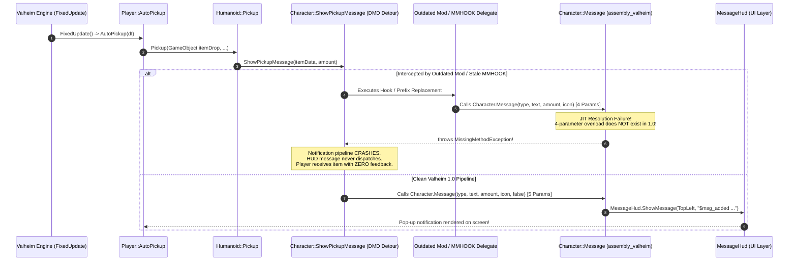

# FAQ-004: Why Does Auto-Pickup Throw MissingMethodException (Character.Message) and Suppress Notifications in Valheim 1.0?

> 📍 **Navigation**: [← Back to README Table of Contents](../../README.md#technical-faq--knowledgebase) | [Knowledgebase Hub](../FAQ.md)

---


| Metadata | Specification |
| :--- | :--- |
| **Category** | Runtime Exceptions & Binary Compatibility |
| **Target Mods** | **HookGenPatcher**, **kg.ItemDrawers**, **BetterPickupNotifications**, **Outdated Pre-1.0 Item/HUD Mods** |
| **Engine / Game** | Valheim 1.0 (Deep North / Unity 6000.0.75) + BepInEx 5.4.2350 |
| **Complexity** | High (IL Reflection, MonoMod HookGen, CLR JIT Dynamic Method Resolution) |
| **Status** | Verified & Root-Caused |

#### 💬 Context & Inquiry

A community player (**NyrZ**) reported an issue where automatic item pickup notifications completely stopped appearing:

> **NyrZ:**  
> *"Anyone knows what could cause this bug (no notification when autopicking up items from ground)*
> ```text
> [Error  : Unity Log] MissingMethodException: Method not found: void .Character.Message(MessageHud/MessageType,string,int,UnityEngine.Sprite)
> Stack trace:
> (wrapper dynamic-method) Character.DMD<Character::ShowPickupMessage>(Character,ItemDrop/ItemData,int)
> (wrapper dynamic-method) Humanoid.DMD<Humanoid::Pickup>(Humanoid,UnityEngine.GameObject,bool,bool)
> (wrapper dynamic-method) Player.DMD<Player::AutoPickup>(Player,single)
> (wrapper dynamic-method) Player.DMD<Player::FixedUpdate>(Player)
> ```
> *I disabled my mods 10 by 10 and it persists everytime. Only mods I didn't disable are the librairies."*

Accompanying log diagnostics revealed two critical clues:
1. `HookGenPatcher` repeatedly bypassing regeneration:
   ```text
   [Info :HookGenPatcher] Previous MMHOOK location found. Using that location to save instead.
   [Info :HookGenPatcher] Already ran for this version, reusing that file.
   ```
2. Automated mod version audits flagging obsolete dependencies:
   ```text
   kg.ItemDrawers 1.4.0 is deprecated
   AzuCraftyBoxes 1.8.19 is deprecated
   AutoDoors 1.0.0 is deprecated
   ```

---

#### ⚡ TL;DR Verdict

The bug is caused by a **breaking method signature shift in Valheim 1.0 (Deep North)**: IronGate added a 5th parameter (`Boolean log`) to `Character.Message`.

In pre-1.0 Valheim, `Character.Message` accepted 4 arguments. In Valheim 1.0, that 4-parameter overload **no longer exists** in `assembly_valheim.dll`. An outdated mod (or a stale `MMHOOK_assembly_valheim.dll` generated prior to the 1.0 update) has hooked `Character.ShowPickupMessage` and compiled against the obsolete 4-parameter signature. When the CLR tries to JIT-compile or execute the detour during `AutoPickup`, it fails to find the 4-argument method and throws `MissingMethodException`, aborting the message before it reaches the HUD.

The player's "10-by-10" elimination test failed because:
1. **HookGenPatcher's stale cache**: HookGen found pre-existing MMHOOK files from before the 1.0 update and logged `Already ran for this version, reusing that file`, keeping broken hook signatures active even when gameplay mods were removed.
2. **Exempting "libraries"**: The player never disabled mods they assumed were harmless libraries (such as patchers, un-updated helper libs, or `kg.ItemDrawers`), guaranteeing the broken code remained loaded on every boot.

---

#### 🔬 Root Cause Engineering Analysis

##### 1. The Breaking API Shift: `Character.Message`
In pre-1.0 Valheim (0.218 / Ashlands), `Character.Message` was defined with 4 parameters:

```csharp
// Pre-1.0 Valheim (assembly_valheim.dll)
public void Message(MessageHud.MessageType type, string msg, int amount = 0, Sprite icon = null)
{
    if (this.m_baseAI != null) return;
    if (MessageHud.instance != null)
    {
        MessageHud.instance.ShowMessage(type, msg, amount, icon);
    }
}
```

In **Valheim 1.0 (Deep North / Unity 6)**, IronGate refactored the HUD messaging pipeline to support chat/event logging directly from messages, appending a 5th parameter `bool log`:

```csharp
// Valheim 1.0 (Deep North, assembly_valheim.dll)
public void Message(MessageHud.MessageType type, string msg, int amount, Sprite icon, bool log)
{
    if (this.m_baseAI != null) return;
    if (MessageHud.instance != null)
    {
        MessageHud.instance.ShowMessage(type, msg, amount, icon, log);
    }
}
```

Because default parameters in C# are baked into IL call sites by the compiler at compile time, any assembly compiled against pre-1.0 emits a `Call` or `Callvirt` to:
`void Character::Message(MessageHud/MessageType, string, int, Sprite)`

Because this method signature no longer exists in Valheim 1.0's metadata table, the .NET runtime throws:
`MissingMethodException: Method not found: void .Character.Message(MessageHud/MessageType,string,int,UnityEngine.Sprite)`

##### 2. Call Site Disassembly: `Character.ShowPickupMessage`
Decompilation of vanilla `assembly_valheim.dll` in Valheim 1.0 reveals that the base game itself cleanly invokes the new 5-parameter method:

```csharp
// Vanilla Valheim 1.0 C# Implementation
public void ShowPickupMessage(ItemDrop.ItemData item, int amount)
{
    this.Message(MessageHud.MessageType.TopLeft, "$msg_added " + item.m_shared.m_name, amount, item.GetIcon(), false);
}
```

Disassembled IL from `assembly_valheim.dll`:
```cil
IL_0000: ldarg.0
IL_0001: ldc.i4.1
IL_0002: ldstr "$msg_added "
IL_0007: ldarg.1
IL_0008: ldfld class ItemDrop/ItemData/SharedData ItemDrop/ItemData::m_shared
IL_000d: ldfld string ItemDrop/ItemData/SharedData::m_name
IL_0012: call string [mscorlib]System.String::Concat(string, string)
IL_0017: ldarg.2
IL_0018: ldarg.1
IL_0019: callvirt instance class [UnityEngine.CoreModule]UnityEngine.Sprite ItemDrop/ItemData::GetIcon()
IL_001e: ldc.i4.0
IL_001f: callvirt instance void Character::Message(valuetype MessageHud/MessageType, string, int32, class [UnityEngine.CoreModule]UnityEngine.Sprite, bool)
IL_0024: ret
```
Notice `IL_001e: ldc.i4.0` pushes `false` and `IL_001f` invokes the 5-parameter signature. Vanilla code **never** calls the 4-parameter overload.

##### 3. Anatomy of the Stack Trace: MonoMod DynamicMethod Detour
The stack trace explicitly identifies a MonoMod DynamicMethod detour:
```text
(wrapper dynamic-method) Character.DMD<Character::ShowPickupMessage>(Character,ItemDrop/ItemData,int)
```
When HarmonyX or MonoMod hooks a method (either via `[HarmonyPatch]` or `On.Character.ShowPickupMessage += ...`), it generates a `DynamicMethodDefinition` (DMD) that replaces the original method body.
When an outdated mod's Prefix, Transpiler, or MonoMod Hook executes inside this DMD, it calls the 4-argument `Character.Message` that was compiled into the mod's binary, triggering the crash.

##### 4. The Stale HookGen Cache Trap
In BepInEx environments utilizing `BepInEx.MonoMod.HookGenPatcher`, HookGen generates on-the-fly hook assemblies (`MMHOOK_assembly_valheim.dll`).
To save boot time, `HookGenPatcher` checks whether an MMHOOK file already exists and whether its size or content hash matches `BepHookGen.size` or `BepHookGen.content`:

```text
[Info :HookGenPatcher] Previous MMHOOK location found. Using that location to save instead.
[Info :HookGenPatcher] Already ran for this version, reusing that file.
```

If a player updates Valheim from 0.218 to 1.0 inside an existing mod manager profile (e.g. Gale, r2modman, Thunderstore Mod Manager), the old `MMHOOK_assembly_valheim.dll` generated under 0.218 remains present. `HookGenPatcher` sees the existing file, assumes it is valid, and skips regeneration. Any mod that attaches to `On.Character.ShowPickupMessage` via MMHOOK inherits obsolete references.

##### 5. The "10-by-10 Disabling Minus Libraries" Testing Fallacy
When modded players troubleshoot crashes, a common pattern is to disable mods in batches of 10 while keeping "libraries" active. This strategy fails when:
1. The bug resides in a mod classified by the user as a "library" (e.g., `ValheimCommunityPatch`, `DrakeModsLibs`, `Jotunn`).
2. The bug is driven by a patcher or hook assembly in `BepInEx/patchers/` or `BepInEx/plugins/MMHOOK/` that persists independently of toggled mod states in mod managers.
3. An un-updated mod (like `kg.ItemDrawers 1.4.0`, which contains hardcoded calls to the 4-parameter `Character.Message`) remains active.

---

#### 📊 Architectural Data Flow



---

#### 🛠️ Workable Solutions & Step-by-Step Triage Runbook

##### Solution A: Purge Stale MMHOOK Assemblies & HookGen Cache (Instant Fix)
Forcing `HookGenPatcher` to rebuild MMHOOK assemblies against Valheim 1.0 resolves stale detour references:
1. Completely exit Valheim.
2. Navigate to your active profile folder:
   - **Gale**: `%APPDATA%\com.kesomannen.gale\valheim\profiles\<ProfileName>\BepInEx\`
   - **r2modman / Thunderstore**: `%APPDATA%\r2modmanPlus-local\Valheim\profiles\<ProfileName>\BepInEx\`
   - **Manual Steam Install**: `C:\Program Files (x86)\Steam\steamapps\common\Valheim\BepInEx\`
3. Delete the following folders and files if present:
   - `BepInEx/plugins/MMHOOK/` (or any `MMHOOK_*.dll` files located in `plugins/` or `patchers/`)
   - `BepInEx/config/HookGenPatcher/`
   - Any `BepHookGen.*` files in `BepInEx/config/` or `BepInEx/cache/`
4. Launch the game. Observe the BepInEx console log:
   ```text
   [Info :HookGenPatcher] Starting HookGenerator...
   [Info :HookGenPatcher] Done.
   ```
   HookGen will generate a clean `MMHOOK_assembly_valheim.dll` reflecting the 5-parameter `Character.Message`.

##### Solution B: Update or Remove Deprecated Pre-1.0 Mods
Several mods that interact with containers, item pickups, or HUD messages call `Character.Message` directly. In NyrZ's mod list:
1. **`kg.ItemDrawers 1.4.0`**: Deprecated. Older builds contain direct calls to the 4-parameter `Character.Message`. Update to a Valheim 1.0 compatible fork (e.g., `Grillspett-GrillspettItemDrawers` or updated `kg.ItemDrawers`).
2. **`AzuCraftyBoxes 1.8.19`**: Deprecated. Update to the latest release or verified Valheim 1.0 container mod.
3. **`AutoDoors 1.0.0`**: Deprecated. Update to `1.1.0+`.
4. **`GetOffMyLawn 0.3.0`**: Outdated. Update to `1.12.0+`.
5. **`BetterPickupNotifications` / `TrueInstantLootDrop`**: If installed, ensure you are on the latest build compiled for Valheim 1.0.

##### Solution C: Perform True Binary Isolation (Zero-Mod Baseline)
If the exception persists after clearing MMHOOK:
1. In your mod manager, disable **ALL** mods, including libraries (`Jotunn`, `DrakeModsLibs`, `ValheimCommunityPatch`, etc.), leaving **only** `BepInExPack`.
2. Launch the game, load into a world, drop an item, and walk over it to verify that auto-pickup notifications appear.
3. Re-enable mods using **Binary Search (Halves)**:
   - Enable 50% of mods. If clean, test the other 50%.
   - When the failing half is identified, divide by half again.
   - **Crucial Rule**: Never exempt libraries or patchers from the binary search.

##### Solution D: Mod Developer Remediation (Harmony & MonoMod Upgrades)
If you are developing or maintaining a mod that hooks or calls `Character.Message`:

**Pre-1.0 Call Site (Broken in 1.0):**
```csharp
character.Message(MessageHud.MessageType.TopLeft, "$msg_added " + item.m_shared.m_name, amount, item.GetIcon());
```

**Valheim 1.0 Call Site (Fixed):**
```csharp
character.Message(MessageHud.MessageType.TopLeft, "$msg_added " + item.m_shared.m_name, amount, item.GetIcon(), false);
```

**Resilient Cross-Version Reflection Call (Compatible with both 0.218 and 1.0):**
```csharp
public static void SafeShowMessage(Character character, MessageHud.MessageType type, string text, int amount, Sprite icon)
{
    var method5 = AccessTools.Method(typeof(Character), nameof(Character.Message),
        new[] { typeof(MessageHud.MessageType), typeof(string), typeof(int), typeof(Sprite), typeof(bool) });

    if (method5 != null)
    {
        method5.Invoke(character, new object[] { type, text, amount, icon, false });
    }
    else
    {
        var method4 = AccessTools.Method(typeof(Character), nameof(Character.Message),
            new[] { typeof(MessageHud.MessageType), typeof(string), typeof(int), typeof(Sprite) });
        method4?.Invoke(character, new object[] { type, text, amount, icon });
    }
}
```

---

#### 🔭 Observability & Diagnostics

##### Step 1: Automated Reflection Audit using `tools/Inspector`
Run the Deep North Testing reflection inspector to audit all installed plugins in under 3 seconds:
```powershell
dotnet run --project c:\work\deepnorthtesting\tools\Inspector
```
The inspector automatically checks core game signatures and flags any plugin assembly calling the obsolete 4-parameter `Character.Message`:
```text
[FAIL] BrokenPlugin.dll: references obsolete 4-parameter Character.Message signature (causes MissingMethodException in Valheim 1.0)
```

##### Step 2: PowerShell Scraper for Obsolete `Character.Message` References
Run this PowerShell script to scan any mod folder for calls to the obsolete 4-parameter signature:
```powershell
Add-Type -Path "C:\Program Files (x86)\Steam\steamapps\common\Valheim\BepInEx\core\Mono.Cecil.dll"
$pluginDir = "C:\Program Files (x86)\Steam\steamapps\common\Valheim\BepInEx\plugins"

Get-ChildItem -Path $pluginDir -Recurse -Filter "*.dll" | ForEach-Object {
    try {
        $mod = [Mono.Cecil.ModuleDefinition]::ReadModule($_.FullName)
        foreach ($mr in $mod.GetMemberReferences()) {
            if ($mr.Name -eq "Message" -and $mr.DeclaringType.Name -eq "Character" -and $mr.Parameters.Count -eq 4) {
                Write-Host "[!] Found obsolete 4-param Character.Message in: $($_.FullName)" -ForegroundColor Red
            }
        }
    } catch {}
}
```

##### Step 3: Verify Clean HookGen Output in `LogOutput.log`
Confirm in `LogOutput.log` that HookGen regenerates rather than reusing stale pre-1.0 files:
```powershell
Select-String -Path "C:\Program Files (x86)\Steam\steamapps\common\Valheim\BepInEx\LogOutput.log" -Pattern "HookGen"
```
Look for:
- `[Info :HookGenPatcher] Starting HookGenerator`
- `[Info :HookGenPatcher] Done.`  
*(If you see `Already ran for this version, reusing that file`, stale MMHOOK assemblies are still cached!)*

---

*End of FAQ-004. For contributions and additions, see the [FAQ Contribution Standard](../FAQ.md#faq-contribution-standard--entry-template).*

> 📍 **Navigation**: [← Back to README Table of Contents](../../README.md#technical-faq--knowledgebase) | [Browse All FAQs in Hub](../FAQ.md)
