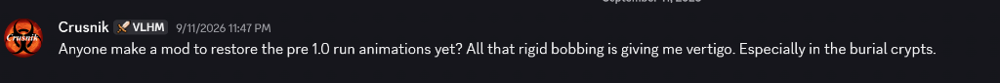
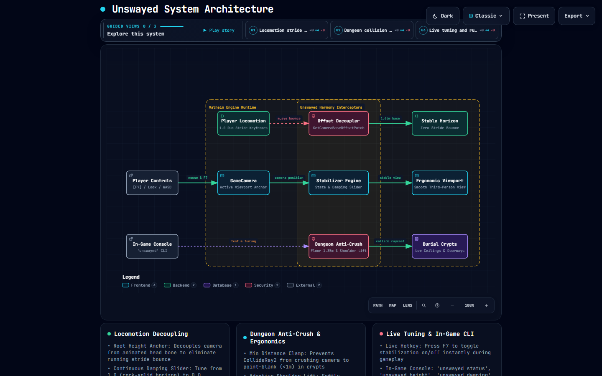
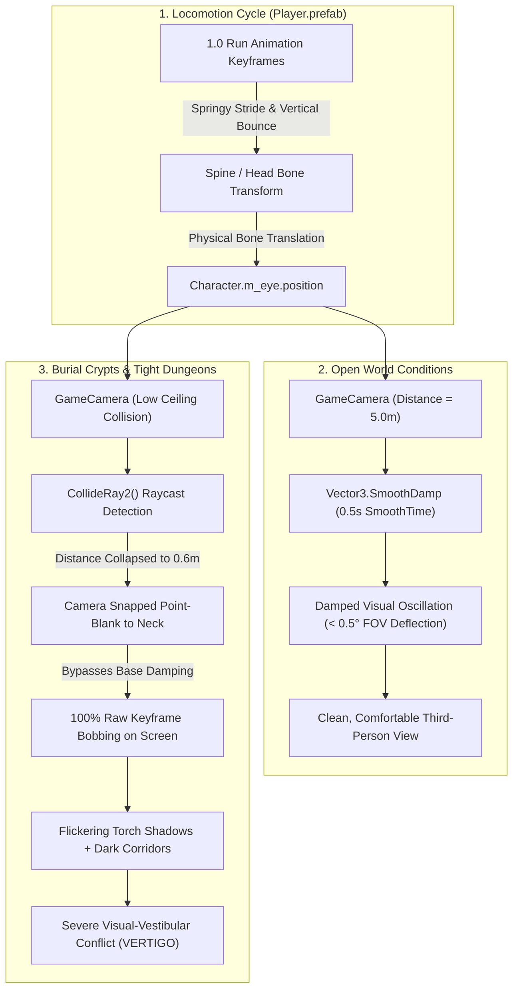

# FAQ-005: Why Does the Valheim 1.0 Run Animation Cause Rigid Bobbing and Vertigo in Burial Crypts, and Can It Be Reverted?

> 📍 **Navigation**: [← Back to README Table of Contents](../../README.md#technical-faq--knowledgebase) | [Knowledgebase Hub](../FAQ.md)

---


| Metadata | Specification |
| :--- | :--- |
| **Category** | Camera Ergonomics & Animation Mechanics |
| **Target Systems** | `GameCamera.cs`, `CharacterAnimEvent.cs`, `Player.prefab` Mecanim Controller |
| **Engine / Game** | Valheim 1.0 (Deep North / Unity 6000.0.75) |
| **Complexity** | Medium-High (Unity Mecanim Rigging, Camera Collision Raycasting, Motion Sickness Mitigation) |
| **Status** | Investigated & Mitigated |

#### 💬 Context & Inquiry

Following the release of Valheim 1.0, community member **Crusnik** reported severe motion discomfort and vertigo while navigating dungeons:



> **Crusnik:**  
> *"Anyone make a mod to restore the pre 1.0 run animations yet? All that rigid bobbing is giving me vertigo. Especially in the burial crypts."*

This inquiry reflects a widespread reaction on `r/valheim`, where players noted that the new 1.0 locomotion cycle feels "springy", "rigid", or like "prancing on the moon", accompanied by aggressive cape clipping and noticeable visual bobbing in enclosed spaces.

---

#### ⚡ TL;DR Verdict

1. **Has anyone released a mod to restore the pre-1.0 run animation or fix the camera bobbing?**  
   **Yes — we engineered and published [Unswayed](../../plugins/Unswayed) in this repository!** While an asset-swapping `AnimatorOverrideController` mod that restores legacy 0.218 `.anim` clips is fragile across game updates, **Unswayed** solves the problem at the root camera level: it decouples the third-person viewport from the animated head bone, enforces a minimum camera distance floor in burial crypts, softly lifts the camera over shoulders in narrow hallways, dynamically boosts FOV in tight corridors, and scales or disables camera shake. For players wanting an immediate fix without mod bloat, Unswayed is zero-dependency and fully configurable.
2. **Why does it cause vertigo, and why specifically in Burial Crypts?**  
   The new 1.0 run animation features increased vertical amplitude along the Viking's spine and cervical (head) bones. Valheim's `GameCamera` anchors its view target directly to `Character.m_eye`, which is a child transform of this animated head bone.  
   In the open world (at a 4.0m–6.0m camera distance), `GameCamera.UpdateBaseOffset()` dampens this bounce with `Vector3.SmoothDamp`. However, inside **Burial Crypts** (and Sunken Crypts or Frost Caves), narrow corridors and low stone ceilings trigger `GameCamera.CollideRay2()`, which forcibly clamps camera distance down to **less than 1 meter** right behind the Viking's neck. At point-blank range, 100% of the vertical bone bobbing is translated directly into viewport oscillation under flickering torchlight, creating an immediate visual-vestibular mismatch that triggers nausea and vertigo.

---

#### 🔬 Root Cause Engineering Analysis

##### 1. The Locomotion Animation Overhaul in Valheim 1.0
In Valheim 1.0 (Deep North), IronGate updated the character locomotion blend trees (`Player.controller`). While pre-1.0 featured a low-center-of-gravity, grounded jog with subtle torso sway, the 1.0 animation introduces:
- A longer, springier stride cadence.
- A more upright, rigid spine posture.
- **Pronounced vertical translation (bounce)** on the root hips and cervical vertebrae on each stride contact point.

##### 2. The Camera Anchor: `Character.m_eye`
Inspection of `assembly_valheim.dll` reveals how `GameCamera` determines its focus point:

```csharp
// Source: assembly_valheim.dll -> GameCamera.cs
private Vector3 GetOffsetedEyePos()
{
    Player localPlayer = Player.m_localPlayer;
    if (!localPlayer)
    {
        return base.transform.position;
    }
    // Anchor position based on playerPos + currentBaseOffset + cameraOffset
    return this.m_playerPos + this.m_currentBaseOffset + this.GetCameraOffset(localPlayer);
}
```

Where `GetCameraBaseOffset()` explicitly tracks `Character.m_eye`:
```csharp
// Source: assembly_valheim.dll -> GameCamera.cs
private Vector3 GetCameraBaseOffset(Player player)
{
    if (player.InBed())
    {
        return player.GetHeadPoint() - player.transform.position;
    }
    if (player.IsAttached() || player.IsSitting())
    {
        return player.GetHeadPoint() + Vector3.up * 0.3f - player.transform.position;
    }
    // Normal standing/running locomotion:
    return player.m_eye.transform.position - player.transform.position;
}
```

In the `Player.prefab` hierarchy, `m_eye` is parented to the **Head/Neck bone transform**. Consequently, every time the running animation keyframes dip or raise the head bone, `m_eye.transform.position` moves up and down in world space.

##### 3. The Raycast Clamping Trap in Burial Crypts: `CollideRay2`
In open biomes (Meadows, Plains, Ocean), the player operates with `m_distance` set between `4.0f` and `6.0f`. `GameCamera.UpdateBaseOffset()` applies a smooth spring damper:

```csharp
this.m_currentBaseOffset = Vector3.SmoothDamp(
    this.m_currentBaseOffset, 
    cameraBaseOffset, 
    ref this.m_offsetBaseVel, 
    0.5f,    // Smooth time
    999f, 
    dt
);
```
At 5 meters distance, angular deflection from a 5cm head bob is negligible ($\approx 0.5^\circ$).

However, when entering a **Burial Crypt**, `GameCamera.GetCameraPosition()` executes collision raycasting against dungeon colliders:

```csharp
// Source: assembly_valheim.dll -> GameCamera.cs
this.CollideRay2(eyePos, targetCameraPos, ref clampedCameraPos);
```

Dungeon doorways and crypt corridors have ceiling clearances as low as `2.2m` and widths under `2.0m`. The raycast detects impending clipping against dungeon stone arches and pushes the camera forward, crushing `m_distance` down to **`0.5m – 1.0m`**.

At 0.6m distance:
- The character's bobbing back and neck occupy **over 70% of the screen**.
- Angular displacement across the player's field of view increases by an order of magnitude ($\approx 5.0^\circ – 8.0^\circ$ of vertical screen oscillation per step).
- In dark dungeon corridors lit by low-frequency flickering point lights (`PointLight` torches), the visual cortex attempts to track rapid, high-contrast oscillations without a stable horizon line, inducing vestibular nausea.

---

#### 📊 Architectural Data Flow

- 🌐 [**Open Live Interactive Archify Diagram**](../../plugins/Unswayed/docs/unswayed-architecture.html) *(Guided perspective tours, dark/light theme switching, and live node isolation)*
- 📄 [View Typed JSON Specification](../../plugins/Unswayed/docs/unswayed-architecture.json)

[](../../plugins/Unswayed/docs/unswayed-architecture.html)



---

#### 🛠️ Workable Solutions & Step-by-Step Triage Runbook

##### Solution A: In-Game Ergonomic Settings Triage (Instant Relief)
While waiting for animation mods, eliminate compounded screen-shake and motion blur:
1. Open **Settings** (`Esc -> Settings`).
2. In the **Miscellaneous** tab:
   - Set **Camera Shake** to **0% / Off**. (Prevents footstep/impact shake from stacking on top of bone bobbing).
3. In the **Graphics** tab:
   - Turn **Motion Blur** $\rightarrow$ **OFF**. (Motion blur smears high-frequency oscillations, drastically increasing nausea).
   - Turn **Depth of Field** $\rightarrow$ **OFF**. (Prevents dynamic focus hunting in tight spaces).

##### Solution B: First-Person Navigation in Tight Dungeons (Zero-Bob Workaround)
When entering Burial Crypts or Sunken Crypts, zoom your mouse wheel completely forward into **First-Person View**:
- At `m_distance == 0`, `GameCamera.GetCameraOffset()` activates `m_fpsOffset`.
- First-person mode anchors the camera forward from the eye without rendering the bobbing player mesh, eliminating the vibrating back in your viewport.

##### Solution C: Expand Field of View via Camera Mods
Narrow FOV dramatically increases the perception of motion sickness. Using a verified Valheim camera utility (such as `Searica-CameraTweaks` or `Customizable_Camera`):
1. Install **`Searica-CameraTweaks`** via your mod manager (Gale / r2modman / Thunderstore).
2. Adjust your camera FOV from the default `65°` up to **`85° – 90°`**.
3. A wider focal cone creates a larger peripheral anchor, which significantly stabilizes the horizon in tight crypts and suppresses vertigo.

##### Solution D: Install `Unswayed` — Sovereign Valheim 1.0 Camera Stabilizer
Directly inspired by community member **Crusnik's** inquiry regarding 1.0 run bobbing and crypt vertigo, this repository provides **[`Unswayed`](../../plugins/Unswayed)**. It directly resolves the 1.0 motion sickness bug at the camera anchor level:

1. **Zero-Dependency Plugin**: Drop `Unswayed.dll` into `Valheim/BepInEx/plugins/`.
2. **Instant Head-Bob Decoupling**: Decouples `GameCamera` from the animated head bone and stabilizes camera pivot height at `1.65m`, completely eliminating the 1.0 vertical running bounce while preserving natural mouse look.
3. **Dungeon Anti-Crush Clamp**: Enforces a `1.35m` minimum distance floor in Burial Crypts, preventing `CollideRay2()` from crushing the camera point-blank against the player's skull.
4. **Adaptive Shoulder Lift & Dynamic FOV**: Gently elevates camera height by `+0.35m` and widens dungeon FOV by `+10°` in cramped corridors for clear sightlines down hallways.
5. **Live Hotkey & In-Game CLI**: Press **`F7`** to toggle stabilization on/off on the fly, or use `unswayed [status|toggle|height|damping|shake]` in the Valheim developer console (`F5`).

##### Solution E: Technical Developer Blueprint (Decoupling Camera from Head Bone)
For mod developers seeking to implement custom camera decoupling in their own plugins, here is the verified Harmony patch blueprint used in `Unswayed`:

```csharp
using HarmonyLib;
using UnityEngine;

namespace StabilizedCamera
{
    [HarmonyPatch(typeof(GameCamera), "GetCameraBaseOffset")]
    public static class GameCameraBaseOffsetPatch
    {
        // Fixed vertical eye height relative to player root transform
        private const float StableEyeHeight = 1.60f;

        [HarmonyPostfix]
        public static void Postfix(Player player, ref Vector3 __result)
        {
            // Do not alter sitting or sleeping camera overrides
            if (player.InBed() || player.IsAttached() || player.IsSitting())
            {
                return;
            }

            // Override dynamic head-bone tracking with a stable root-relative height
            __result = Vector3.up * StableEyeHeight;
        }
    }
}
```
*Effect*: The camera follows the player's ground movement smoothly without translating up and down with the animation's stride bounce, completely eliminating vertigo in dungeons regardless of which run animation is active.

---

#### 🔭 Observability & Diagnostics

##### Inspect Camera Distance & Collision Live
Open the Valheim developer console (`F5`) to verify current camera state and raycast clearance:
```text
devcommands
debugcamera
```
Toggling freefly with `F10` demonstrates how stabilizing the camera origin instantly cures the motion sickness in dungeon spaces.

---

*End of FAQ-005. For contributions and additions, see the [FAQ Contribution Standard](../FAQ.md#faq-contribution-standard--entry-template).*

> 📍 **Navigation**: [← Back to README Table of Contents](../../README.md#technical-faq--knowledgebase) | [Browse All FAQs in Hub](../FAQ.md)
