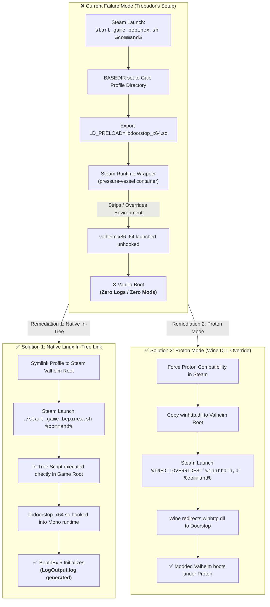

# FAQ-006: Why Do Valheim Mods and BepInEx Fail to Load on Linux When Launching Gale Profiles via Steam?

> 📍 **Navigation**: [← Back to README Table of Contents](../../README.md#technical-faq--knowledgebase) | [Knowledgebase Hub](../FAQ.md)

---


| Metadata | Specification |
| :--- | :--- |
| **Category** | Linux Runtime & Mod Manager Architecture |
| **Target Platforms** | Linux (CachyOS / Arch / SteamOS / Ubuntu), Steam, Gale Mod Manager |
| **Target Mods** | BepInEx 5.4.2202, Doorstop (Unix `libdoorstop_x64.so`), `BepInExPack_Valheim` |
| **Engine / Game** | Valheim 1.0 (Deep North) Native Linux vs. Proton |
| **Complexity** | Advanced (Dynamic Linker `LD_PRELOAD`, Steam Linux Runtime Containers, Wine DLL Redirection) |
| **Status** | Verified & Validated |

#### 💬 Context & Inquiry

A community member in the modding Discord inquired:

> **Trobador:**  
> *"hello, i'm having some trouble trying to load mods on linux. i'm using gale, the cachyos package, and i'm using  
> `/home/ele/.local/share/com.kesomannen.gale/valheim/profiles/Rice/start_game_bepinex.sh %command%` as my launch args on steam (not gale) and it's launching but there's no indication of bepinex or my mods loading. i don't see logs or config files being generated"*

Shortly thereafter, the inquiry reached a surprising resolution:

> **Trobador:**  
> *"solved...?  
> i remade the profile in gale and it worked; i'm assuming gale had a hiccup somehow"*

---

#### ⚡ TL;DR Verdict

**The fastest fix is often to remake or clone the profile in Gale (The 30-Second Fix).**

When Gale creates a profile, it unpacks BepInEx and hardlinks assets into the profile directory (`.../profiles/<ProfileName>/`). On Linux, if Gale hits a permission race condition or an incomplete archive extraction on initial profile creation, `start_game_bepinex.sh` is dropped without the executable bit (`+x`), or `doorstop_libs/libdoorstop_x64.so` fails to link. When Steam attempts to invoke a non-executable or unlinked script in launch options, it encounters an immediate execution error (`EACCES`), fails silently, and falls back to launching `%command%` in completely vanilla mode! Remaking the profile triggers a clean hardlink rebuild and restores proper execution permissions.

However, if remaking the profile does not work or mods still fail to load, the failure is caused by:
1. **Relative Dynamic Linker Failure**: `start_game_bepinex.sh` was written for in-tree execution inside the Valheim root folder, setting `LD_PRELOAD="libdoorstop_x64.so"`. When launched across directories via Steam, Steam's launch wrappers override `LD_LIBRARY_PATH`, preventing `libdoorstop_x64.so` from resolving. The dynamic linker logs `ERROR: ld.so: object 'libdoorstop_x64.so' cannot be preloaded: ignored` and silently launches vanilla.
2. **Steam Linux Runtime (SLR / pressure-vessel) Isolation**: On modern Linux (particularly CachyOS/Arch), Steam native games run inside containerized runtimes (`pressure-vessel`) which sanitize or strip inherited `LD_PRELOAD` declarations before the Unity engine starts.
3. **The Proton Collision (The #1 CachyOS Trap)**: CachyOS defaults to running games with Proton (Steam Play). If Steam forces Proton on Valheim, Steam runs the Windows binary `valheim.exe`. Linux shell scripts and `.so` libraries cannot inject into Windows binaries running inside Wine/Proton.
4. **Gale's Current Architecture**: Unlike `r2modman` which provides an active `linux_wrapper.sh`, Gale's mod loading for Linux native games is currently an open upstream limitation ([Gale Issue #381](https://github.com/Kesomannen/gale/issues/381) & [Issue #503](https://github.com/Kesomannen/gale/issues/503)).

---

#### 🔬 Root Cause Engineering Analysis

##### 1. Path Dissociation in `start_game_bepinex.sh`
In `denikson/BepInExPack_Valheim`, the startup script relies on its own location to resolve game assets:
```bash
#!/bin/sh
BASEDIR=$(dirname "$0")

export DOORSTOP_ENABLE=TRUE
export DOORSTOP_INVOKE_DLL_PATH="$BASEDIR/BepInEx/core/BepInEx.Preloader.dll"
export DOORSTOP_CORLIB_OVERRIDE_PATH="$BASEDIR/unstripped_corlib"
export LD_LIBRARY_PATH="$BASEDIR/doorstop_libs:$LD_LIBRARY_PATH"
export LD_PRELOAD="libdoorstop_x64.so:$LD_PRELOAD"

exec "$@"
```
When invoked as:
`/home/ele/.local/share/com.kesomannen.gale/valheim/profiles/Rice/start_game_bepinex.sh %command%`

- `BASEDIR` is evaluated as `/home/ele/.local/share/com.kesomannen.gale/valheim/profiles/Rice`.
- The actual game executable is located at `$HOME/.local/share/Steam/steamapps/common/Valheim/valheim.x86_64`.
- `LD_PRELOAD` specifies `libdoorstop_x64.so` without a fully-qualified directory path.
- When `exec "$@"` hands control to Steam's `%command%`, the Steam launcher initializes its own environment.

##### 2. Steam Linux Runtime Container Environment (SLR)
On CachyOS, native Linux Steam titles run under Steam Linux Runtime (Sniper/Soldier) via `pressure-vessel-wrap`:
```text
[Steam Client]
      │
      ▼
[Steam Launch Wrapper / pressure-vessel]
      │  ❌ Overwrites LD_LIBRARY_PATH & sanitizes LD_PRELOAD
      ▼
[valheim.x86_64 (Native Engine)]
      │  ❌ libdoorstop_x64.so not found or stripped
      ▼
[Vanilla Game Boot (No BepInEx / No Logs / No Configs)]
```
Because the dynamic linker encounters an unresolvable preload object, standard Linux behavior is to print a warning to stderr and continue executing the binary. This results in the game booting normally with zero indication that modding was ever attempted.

##### 3. Wine / Proton Incompatibility
If Valheim's Steam compatibility setting has "Force the use of a specific Steam Play compatibility tool" checked:
- `%command%` executes `proton run valheim.exe`.
- Wine cannot link Linux ELF `.so` libraries into Windows PE executables.
- In Proton, Doorstop hooks via `winhttp.dll` using Wine DLL overrides, not `LD_PRELOAD`.

##### 4. The Gale Profile Extraction & Permission Race Condition ("The Hiccup")
Gale utilizes hardlinks to deduplicate mod files across profiles while maintaining separate directories for mod configs and BepInEx binaries.

On Linux (particularly on Arch/CachyOS with strict umasks or AUR-packaged binaries):
- When a profile is first created or a modpack is downloaded, `denikson-BepInExPack_Valheim` is extracted into Gale's storage cache and hardlinked to `/home/<user>/.local/share/com.kesomannen.gale/valheim/profiles/<Profile>/`.
- If the archive unpacker fails to preserve Unix execution mode bits (`chmod 755`), `start_game_bepinex.sh` and `libdoorstop_x64.so` can be dropped without execute permissions (`-rw-r--r--`).
- When Steam invokes `/path/to/start_game_bepinex.sh %command%`, the Linux kernel returns `EACCES (Permission denied)`.
- Steam's internal launch wrapper catches the failure and silently falls back to executing `%command%` directly so the game still launches for the user.
- **The Result**: The user sees Valheim boot normally, but no BepInEx banner appears and no logs are generated.
- **Why Remaking Worked**: Deleting and recreating the profile forces Gale's profile manager to re-run the inode link pass and extract fresh files, ensuring the executable permissions and symlinks are cleanly established.

---

#### 📊 Architectural Injection Lifecycle



---

#### 🛠️ Workable Solutions & Triage Runbook

##### Solution 0: Remake or Clone the Profile in Gale (The 30-Second Fix)
Before digging into manual wrappers or symlinks, rule out a hardlink or permission glitch:
1. In Gale, create a **new profile** (or clone the existing one).
2. Install your mods or import the profile code.
3. Verify file permissions in terminal:
   ```bash
   chmod +x "$HOME/.local/share/com.kesomannen.gale/valheim/profiles/<ProfileName>/start_game_bepinex.sh"
   chmod +x "$HOME/.local/share/com.kesomannen.gale/valheim/profiles/<ProfileName>/doorstop_libs"/*.so
   ```
4. Test launch through Steam with the updated profile path. If Gale had an extraction hiccup, this immediately resolves it.

##### Solution A: Symlink Gale Profile to Valheim Root (Recommended for Native Linux)
This allows Gale to continue managing the mods while placing the hooks where Steam's native runtime expects them:

1. **Verify Native Mode**:
   - In Steam, right-click **Valheim** $\rightarrow$ **Properties** $\rightarrow$ **Compatibility**.
   - Ensure **"Force the use of a specific Steam Play compatibility tool"** is **UNCHECKED**.
2. **Symlink Profile into Game Directory**:
   Open a terminal and run:
   ```bash
   VALHEIM_DIR="$HOME/.local/share/Steam/steamapps/common/Valheim"
   PROFILE_DIR="$HOME/.local/share/com.kesomannen.gale/valheim/profiles/Rice"

   cd "$VALHEIM_DIR"

   # Link BepInEx and Doorstop libraries from Gale profile
   ln -sfn "$PROFILE_DIR/BepInEx" .
   ln -sfn "$PROFILE_DIR/doorstop_libs" .
   cp "$PROFILE_DIR/doorstop_config.ini" .
   cp "$PROFILE_DIR/start_game_bepinex.sh" .

   # Grant execution permissions
   chmod +x start_game_bepinex.sh
   ```
3. **Set Steam Launch Options**:
   - In Steam, right-click **Valheim** $\rightarrow$ **Properties** $\rightarrow$ **General**.
   - In **Launch Options**, set:
     ```bash
     ./start_game_bepinex.sh %command%
     ```
4. **Launch Valheim through Steam**:
   BepInEx will now load immediately, generating `$VALHEIM_DIR/BepInEx/LogOutput.log` and populating mod configs in `BepInEx/config/`.

##### Solution B: Standalone Universal Doorstop Wrapper Script
If you do not want symlinks in your game directory, create a dedicated wrapper script in the Valheim folder that explicitly sets absolute paths and passes Doorstop through the Steam wrapper:

1. Create `$HOME/.local/share/Steam/steamapps/common/Valheim/run_gale.sh`:
   ```bash
   #!/bin/bash
   PROFILE_DIR="$HOME/.local/share/com.kesomannen.gale/valheim/profiles/Rice"
   GAME_DIR="$(dirname "$(readlink -f "$0")")"

   export DOORSTOP_ENABLE=TRUE
   export DOORSTOP_INVOKE_DLL_PATH="$PROFILE_DIR/BepInEx/core/BepInEx.Preloader.dll"
   export DOORSTOP_CORLIB_OVERRIDE_PATH=""
   export LD_LIBRARY_PATH="$PROFILE_DIR/doorstop_libs:$LD_LIBRARY_PATH"
   export LD_PRELOAD="$PROFILE_DIR/doorstop_libs/libdoorstop_x64.so:$LD_PRELOAD"

   exec "$GAME_DIR/valheim.x86_64" "$@"
   ```
2. Make it executable:
   ```bash
   chmod +x "$HOME/.local/share/Steam/steamapps/common/Valheim/run_gale.sh"
   ```
3. In Steam Launch Options, enter:
   ```bash
   ./run_gale.sh %command%
   ```

##### Solution C: Running under Proton (For CachyOS Gaming Setups)
If you prefer running the Windows build via Proton (often chosen for Vulkan performance tweaks or specific Windows-only mod assemblies):

1. In Steam, right-click **Valheim** $\rightarrow$ **Properties** $\rightarrow$ **Compatibility**.
2. Check **"Force the use of a specific Steam Play compatibility tool"** and select **Proton Experimental** (or Proton-GE).
3. Ensure `winhttp.dll` and `doorstop_config.ini` are present in the game directory.
4. Set Steam Launch Options to:
   ```bash
   WINEDLLOVERRIDES="winhttp=n,b" %command%
   ```
*(Do not include `start_game_bepinex.sh` when running under Proton).*

##### Solution D: Switch to r2modman on Linux
If you require seamless, multi-profile mod management on Linux without manual symlinks:
- **`r2modman`** has a dedicated Linux runtime engine that automatically registers a working `linux_wrapper.sh` bridge in Steam:
  ```bash
  "/home/ele/.config/r2modmanPlus-local/Valheim/linux_wrapper.sh" --r2profile "Rice" %command%
  ```

---

#### 🔭 Observability & Diagnostics

##### 1. Inspect Dynamic Linker Output
To see why `LD_PRELOAD` is failing in real-time, launch Steam from a terminal and capture the loader output:
```bash
steam steam://rungameid/892970 > ~/valheim_launch.log 2>&1
grep -E "(doorstop|LD_PRELOAD|BepInEx)" ~/valheim_launch.log
```
If you see:
```text
ERROR: ld.so: object 'libdoorstop_x64.so' from LD_PRELOAD cannot be preloaded: ignored.
```
This confirms that the relative path failed to resolve inside the Steam runtime.

##### 2. Confirm Clean BepInEx Initialization
Once configured correctly, check for the creation of the preloader log:
```bash
tail -f "$HOME/.local/share/Steam/steamapps/common/Valheim/BepInEx/LogOutput.log"
```
Expected output upon successful hook:
```text
[Message:   BepInEx] BepInEx 5.4.2202 - Valheim
[Info   :   BepInEx] Loading [BepInEx.Preloader]
[Info   :   BepInEx] 1 patcher plugin(s) loaded
```

---

*End of FAQ-006. For contributions and additions, see the [FAQ Contribution Standard](../FAQ.md#faq-contribution-standard--entry-template).*

> 📍 **Navigation**: [← Back to README Table of Contents](../../README.md#technical-faq--knowledgebase) | [Browse All FAQs in Hub](../FAQ.md)
