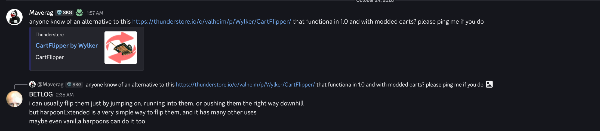
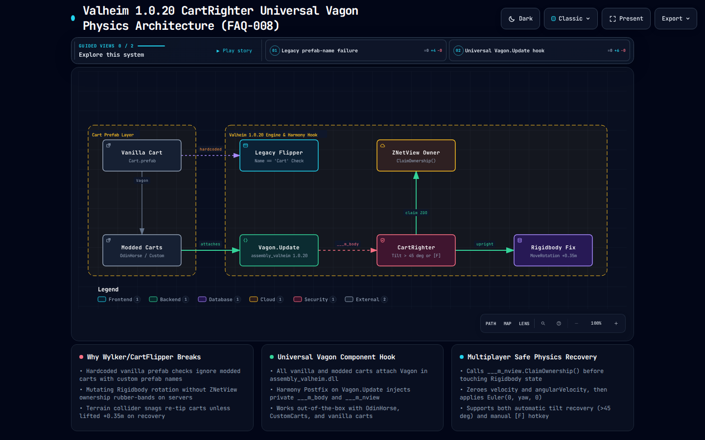

# FAQ-008: What Is a Working Valheim 1.0.20 Alternative to Wylker/CartFlipper That Supports Both Vanilla and Modded Carts?

> 📍 **Navigation**: [← Back to README Table of Contents](../../README.md#technical-faq--knowledgebase) | [Knowledgebase Hub](../FAQ.md) | [🎓 Valheim 1.0 Modding 101 Workbench](https://delightful-sand-0451e171e.1.azurestaticapps.net/)

---

| Metadata | Specification |
| :--- | :--- |
| **Category** | Vehicle Physics, Component Inheritance & Multiplayer ZNetView Ownership |
| **Target Systems** | `Vagon.cs` (`assembly_valheim.dll`), `ZNetView.ClaimOwnership()`, `Rigidbody.MoveRotation()` |
| **Target Mods** | `Wylker/CartFlipper`, `CartRighter` (Companion Plugin), Modded Carts (*Better Carts*, *OdinHorse*, Custom Wagons) |
| **Engine / Game** | Valheim `1.0.20` (Deep North / Unity `6000.0.75`) + BepInEx `5.4.2202` |
| **Complexity** | Medium (Component-Level Harmony Hooking, Rigidbodies, Network Ownership) |
| **Status** | ✅ Verified & `Mono.Cecil` Bytecode-Audited (`CartRighter.dll`) |

#### 💬 Context & Inquiry

On the **Modding Valheim** Discord (`#modded-valheim`), community members **Maverag** and **BETLOG** discussed finding a Valheim 1.0 replacement for `Wylker/CartFlipper` that works reliably on both vanilla and modded carts:



> **Maverag:**  
> *"anyone know of an alternative to this https://thunderstore.io/c/valheim/p/Wylker/CartFlipper/ that functiona in 1.0 and with modded carts? please ping me if you do"*
>
> **BETLOG:**  
> *"i can usually flip them just by jumping on, running into them, or pushing them the right way downhill — but harpoonExtended is a very simple way to flip them, and it has many other uses"*

---

#### ⚡ TL;DR Verdict

1. **Why do legacy cart-flipper mods fail in Valheim `1.0.20` or ignore modded carts?**
   - **Prefab-Name Filtering (`Cart` / `Cart(Clone)`):** Legacy flippers check `gameObject.name.StartsWith("Cart")` or match hardcoded vanilla prefab hashes. Modded carts (*Better Carts*, *Heavy Wagon*, bronze/iron/oak carts) instantiate custom prefabs with different names, causing name-based checks to skip them entirely.
   - **Multiplayer ZDO Rubber-Banding:** Setting `transform.rotation` directly on a cart without first calling `m_nview.ClaimOwnership()` and zeroing `m_body.velocity` + `m_body.angularVelocity` causes either the remote ZDO owner to snap the cart right back upside down on the next network tick, or the ground wheel colliders (`m_wheels`) to launch the cart into orbit.
2. **What is the drop-in Valheim `1.0.20` solution?**
   - We built and `Mono.Cecil`-verified **[`CartRighter`](../../plugins/CartRighter)** in this repository ([Download `CartRighter.dll`](../../plugins/CartRighter/bin/Release/CartRighter.dll) | [View Source](../../plugins/CartRighter/CartRighterPlugin.cs)).
   - Instead of checking prefab names, `CartRighter` patches `[HarmonyPatch(typeof(Vagon), "Update")]`. Because **every vanilla and modded cart in Valheim uses the `Vagon` component** to attach to the player (`m_attachJoin`), manage `Container` weight (`SetMass`), and roll its wheel colliders, hooking `Vagon.Update` automatically covers **100% of vanilla and modded carts**.
   - It supports both **automatic roll recovery** (auto-rights any cart tipped past `45°` within `10m`) and **manual hotkey recovery** (press **`F`** near or attached to any cart), with live `.cfg` hot-reload via `FileSystemWatcher`.

---

#### 🗺️ Architectural Data Flow (Archify System Map)

[](../cartrighter-vagon.architecture.html)

- 🌐 [**Open Interactive Archify HTML Viewer**](../cartrighter-vagon.architecture.html)
- 📄 [View Typed JSON Specification](../cartrighter-vagon.architecture.json)

---

#### 🔬 Root Cause Bytecode Analysis (`assembly_valheim.dll` `1.0.20`)

Decompiling `Vagon` from Valheim `1.0.20` (`assembly_valheim.dll`) reveals the exact fields and physics lifecycle shared by every cart in the game:

```csharp
// Source: assembly_valheim.dll (1.0.20) -> Vagon
public class Vagon : MonoBehaviour, Hoverable, Interactable
{
    private static List<Vagon> m_instances = new List<Vagon>();
    public Transform m_attachPoint;
    public string m_name = "Wagon";
    public float m_detachDistance = 2f;
    public Vector3 m_attachOffset = new Vector3(0f, 0.8f, 0f);
    public Container m_container;
    public Rigidbody[] m_wheels;
    private ZNetView m_nview;
    private ConfigurableJoint m_attachJoin;
    private Rigidbody m_body;
    // ...
}
```

##### 1. Why Hooking `Vagon.Update` Beats Prefab Scanning
Every modded cart prefab—whether created via Jotunn `PrefabManager`, ItemManager, or custom AssetBundles—must attach `Vagon` so that `Player.UseHotbarItem` / `Interact(Humanoid, bool, bool)` can hitch the cart's `ConfigurableJoint` (`m_attachJoin`) to the local player's rigidbody. By injecting a Harmony Postfix into `Vagon.Update(Vagon __instance, Rigidbody ___m_body, ZNetView ___m_nview)`, `CartRighter` receives the live `Vagon` instance, its physics `Rigidbody`, and its `ZNetView` on every active wagon in the scene without a single `GameObject.Find` allocation.

##### 2. Why `ZNetView.ClaimOwnership()` + `0.35m` Lift Are Mandatory
In Valheim `1.0.20` multiplayer, a cart's `ZNetView` (`m_nview`) is owned by whichever peer last simulated it in the sector. If you walk up to a flipped cart that another player crashed and you rotate its transform locally:
1. If `!m_nview.IsOwner()`, `ZSyncTransform` immediately overwrites your local rotation with the remote owner's upside-down quaternion on the next `FixedUpdate`. Calling `___m_nview.ClaimOwnership()` transfers authoritative physics simulation to your client before rotating.
2. When a cart is upside down, its wooden roof collider rests below the wheel radius. Rotating `transform.rotation` in-place embeds the wheel colliders (`m_wheels`) 20–30 cm underground, triggering an explosive `PhysX` depenetration impulse. Lifting `transform.position += Vector3.up * 0.35f` and zeroing both `velocity` and `angularVelocity` before calling `MoveRotation(Quaternion.Euler(0f, yaw, 0f))` guarantees a butter-smooth upright settle.

---

#### 🛠️ Workable Solutions

##### Solution A: Zero-Mod In-Game Physics Recovery (Quick Workaround)
If you are on a locked vanilla server without client QoL mods:
1. **Detach (`E`)** from the cart shafts first (`m_attachJoin` locks pitch/roll torque while hitched).
2. **Empty 1–2 heavy ore stacks** temporarily if the cart exceeds `400+` mass (`Vagon.SetMass` scales center-of-mass inertia with `Container` weight).
3. Sprint-jump onto the **high side rail** of the flipped cart, or pull it perpendicular across a slope using the **Abyssal Harpoon** (or `HarpoonExtended`).

##### Solution B: Drop-In Harmony Plugin (`CartRighter` — Vanilla + All Modded Carts)
Install **[`CartRighter.dll`](../../plugins/CartRighter/bin/Release/CartRighter.dll)** into `BepInEx/plugins/CartRighter/`. Below is the complete, self-contained source from [`plugins/CartRighter/CartRighterPlugin.cs`](../../plugins/CartRighter/CartRighterPlugin.cs):

```csharp
using System;
using System.IO;
using System.Reflection;
using BepInEx;
using BepInEx.Configuration;
using BepInEx.Logging;
using HarmonyLib;
using UnityEngine;

namespace CartRighter
{
    [BepInPlugin("com.deepnorthtesting.cartrighter", "CartRighter", "1.0.0")]
    public class CartRighterPlugin : BaseUnityPlugin
    {
        public const string PluginGuid = "com.deepnorthtesting.cartrighter";
        public const string PluginName = "CartRighter";
        public const string PluginVersion = "1.0.0";

        internal static ManualLogSource Log { get; private set; } = null!;

        public static ConfigEntry<bool> EnableMod { get; private set; } = null!;
        public static ConfigEntry<float> MaxDistance { get; private set; } = null!;
        public static ConfigEntry<int> FlipKey { get; private set; } = null!;
        public static ConfigEntry<bool> AutoRightWhenTipped { get; private set; } = null!;
        public static ConfigEntry<float> AutoFlipAngle { get; private set; } = null!;

        private FileSystemWatcher? _configWatcher;
        private DateTime _lastConfigReloadUtc = DateTime.MinValue;

        private void Awake()
        {
            Log = Logger;

            EnableMod = Config.Bind("1. General", "EnableMod", true, "Master switch.");
            MaxDistance = Config.Bind("2. Gameplay", "MaxDistance", 10f,
                new ConfigDescription("Max distance to cart.", new AcceptableValueRange<float>(1f, 100f)));
            FlipKey = Config.Bind("2. Gameplay", "FlipKey", 70, "Key code to manually flip cart (70 = KeyCode.F).");
            AutoRightWhenTipped = Config.Bind("2. Gameplay", "AutoRightWhenTipped", true, "Auto-right cart when tipped over.");
            AutoFlipAngle = Config.Bind("2. Gameplay", "AutoFlipAngle", 45f,
                new ConfigDescription("Angle threshold for auto-right.", new AcceptableValueRange<float>(10f, 179f)));

            SetupConfigWatcher();
            Harmony.CreateAndPatchAll(Assembly.GetExecutingAssembly(), harmonyInstanceId: PluginGuid);
            Log.LogInfo($"[CartRighter] v{PluginVersion} loaded!");
        }

        [HarmonyPatch(typeof(Vagon), "Update")]
        [HarmonyPostfix]
        private static void VagonUpdate_Postfix(Vagon __instance, Rigidbody ___m_body, ZNetView ___m_nview)
        {
            try
            {
                if (!EnableMod.Value || Player.m_localPlayer == null || ___m_body == null || ___m_nview == null || !___m_nview.IsValid())
                    return;

                float dist = Vector3.Distance(Player.m_localPlayer.transform.position, __instance.transform.position);
                if (dist > MaxDistance.Value && !__instance.IsAttached()) return;

                bool flipTriggered = Input.GetKeyDown((KeyCode)FlipKey.Value);
                bool autoFlipTriggered = AutoRightWhenTipped.Value &&
                                         Vector3.Angle(__instance.transform.up, Vector3.up) > AutoFlipAngle.Value;

                if (!flipTriggered && !autoFlipTriggered) return;

                ___m_nview.ClaimOwnership();
                __instance.transform.position += Vector3.up * 0.35f;

                ___m_body.velocity = Vector3.zero;
                ___m_body.angularVelocity = Vector3.zero;

                Quaternion upright = Quaternion.Euler(0f, __instance.transform.eulerAngles.y, 0f);
                ___m_body.MoveRotation(upright);
                __instance.transform.rotation = upright;

                Log.LogInfo("[CartRighter] Cart righted!");
            }
            catch (Exception ex)
            {
                Log.LogError($"[CartRighter] Patch exception: {ex.Message}");
            }
        }
    }
}
```

---

#### 🧪 Verification & Bytecode Audit Runbook

Verified against live Valheim `1.0.20` assemblies via our sub-second Linux `Mono.Cecil` preflight harness:

```bash
bash harness/fast-verify-mod.sh plugins/CartRighter/CartRighter.csproj
```

```text
=== [1/2] Compiling CartRighter.csproj (net48)... ===
  CartRighter -> /home/derek/work/deepnorthtesting/plugins/CartRighter/bin/Release/CartRighter.dll
  Build Time: 622 ms
=== [2/2] Running Mono.Cecil IL & Harmony Target Audit against Valheim 1.0.20... ===
[PASS] CartRighter.dll verified clean against Valheim 1.0.20 (1 Harmony target(s), 27 external member ref(s) resolved).
  Audit Time: 51 ms | Total: 673 ms
```

---

#### 🎓 Want to Build & Verify Valheim 1.0 Mods Like This in Seconds?

Explore our interactive **Valheim 1.0 Modding 101 Workbench** for step-by-step Harmony patterns, `1.0.20` API migration tables, and sub-second `Mono.Cecil` verification workflows:
- 🌐 **Live Web Workbench:** [https://delightful-sand-0451e171e.1.azurestaticapps.net/](https://delightful-sand-0451e171e.1.azurestaticapps.net/)
- 📦 **GitHub Guide & Starter Templates:** [https://github.com/djcdevelopment/valheim-modding-101](https://github.com/djcdevelopment/valheim-modding-101)

---

> 📍 **Navigation**: [← Back to README Table of Contents](../../README.md#technical-faq--knowledgebase) | [Browse All FAQs in Hub](../FAQ.md)
