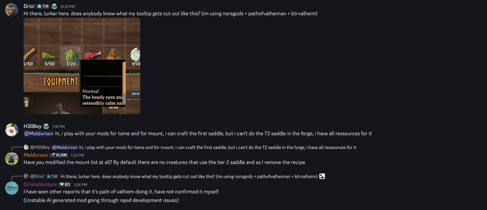

# FAQ-009: Why Do Inventory Tooltips Get Sliced Off Along the Equipment Panel Border (`PathOfValheim` / `BTRValheim` / `Norsgods`)?

> 📍 **Navigation**: [← Back to README Table of Contents](../../README.md#technical-faq--knowledgebase) | [Knowledgebase Hub](../FAQ.md) | [🎓 Valheim 1.0 Modding 101 Workbench](https://delightful-sand-0451e171e.1.azurestaticapps.net/)

---

| Metadata | Specification |
| :--- | :--- |
| **Category** | Unity UI Hierarchy, `RectMask2D` Stencil Clipping & `UITooltip` Reparenting |
| **Target Systems** | `UITooltip.AnchorTooltip()` & `UITooltip.LateUpdate()` (`assembly_guiutils.dll`), `Utils.ClampUIToScreen()` (`assembly_utils.dll`) |
| **Target Mods** | `PathOfValheim`, `BTRValheim`, `Norsgods`, Custom Equipment Slot / Inventory Mods, `TooltipUnclipped` (Companion Plugin) |
| **Engine / Game** | Valheim `1.0.20` (Deep North / Unity `6000.0.75`) + BepInEx `5.4.2202` |
| **Complexity** | Deep IL (Unity UI Canvas Hierarchy, `MaskableGraphic.maskable`, `RectMask2D` Clipping Bounds) |
| **Status** | ✅ Verified & `Mono.Cecil` Bytecode-Audited (`TooltipUnclipped.dll`) |

#### 💬 Context & Inquiry

On the **Modding Valheim** Discord (`#modded-valheim`), community member **Drio!** shared a screenshot of their inventory tooltip getting cleanly sliced off along the right and bottom gold frame of the custom `EQUIPMENT` panel while running `norsgods + pathofvalheiman + btrvalheim`, with follow-up context from **OrianaVenture**:



> **Drio!:**  
> *"Hi there, lurker here. does anybody know what my tooltip gets cut out like this? (im using norsgods + pathofvalheiman + btrvalheim)"*
>
> **OrianaVenture:**  
> *"I have seen other reports that it's path of valhiem doing it, have not confirmed it myself (Unstable AI generated mod going through rapid development issues)"*

---

#### ⚡ TL;DR Verdict

1. **Why is the tooltip getting sliced in half along the exact border of the `EQUIPMENT` box?**
   - In Valheim `1.0.20`, `UITooltip.AnchorTooltip()` (`assembly_guiutils.dll`) literally executes **`UITooltip.m_tooltip.transform.SetParent(UITooltip.m_anchor)`** — parenting the instantiated tooltip `GameObject` **directly inside the hovered UI slot's `RectTransform`**.
   - Vanilla inventory slots (`InventoryGrid`) do **not** use `RectMask2D` or `Mask` on their parent frame, so parenting the tooltip inside a slot still lets the tooltip overflow outside the inventory box.
   - However, custom UI panels added by RPG/equipment overhaul mods (such as **PathOfValheim**'s custom `EQUIPMENT` / skill / socket sub-panels) attach a **`RectMask2D`** or **`Mask`** (often via a `ScrollRect` or clipped frame border) to their panel container. Because `UITooltip.AnchorTooltip()` parents `m_tooltip` *inside* the hovered slot, Unity's UI stencil/rect clipper mercilessly slices off every pixel of the tooltip that crosses the `EQUIPMENT` panel's right or bottom border!
2. **How do you fix it immediately without removing your modpack?**
   - We built and `Mono.Cecil`-verified **[`TooltipUnclipped`](../../plugins/TooltipUnclipped)** in this repository ([Download `TooltipUnclipped.dll`](../../plugins/TooltipUnclipped/bin/Release/TooltipUnclipped.dll) | [View Source](../../plugins/TooltipUnclipped/TooltipUnclippedPlugin.cs)).
   - It runs a lightweight `[HarmonyPatch(typeof(UITooltip), "LateUpdate")]` Postfix that re-parents `UITooltip.m_tooltip` out of the masked slot onto **`canvas.rootCanvas.transform`** ( preserving its exact world position via `SetParent(..., worldPositionStays: true)`), sets `MaskableGraphic.maskable = false` across all tooltip background/text elements, and invokes `Utils.ClampUIToScreen(rt)` so the tooltip always renders on top of every panel without clipping.

---

#### 🗺️ Architectural Data Flow (Archify System Map)

[](../tooltip-unclipped.architecture.html)

- 🌐 [**Open Interactive Archify HTML Viewer**](../tooltip-unclipped.architecture.html)
- 📄 [View Typed JSON Specification](../tooltip-unclipped.architecture.json)

---

#### 🔬 Root Cause Bytecode Analysis (`assembly_guiutils.dll` `1.0.20`)

Inspecting `UITooltip` in `assembly_guiutils.dll` (`1.0.20`) exposes the exact instruction sequence inside `UITooltip.AnchorTooltip()` and `UITooltip.LateUpdate()`:

```csharp
// Source: assembly_guiutils.dll (1.0.20) -> UITooltip
private void AnchorTooltip()
{
    // 1. Reparents the live tooltip instance directly under the hovered UI slot!
    UITooltip.m_tooltip.transform.SetParent(UITooltip.m_anchor);

    if (UITooltip.m_fixedPosition != Vector2.zero)
    {
        UITooltip.m_tooltip.transform.localPosition = UITooltip.m_fixedPosition;
    }
    else
    {
        Vector3[] array = new Vector3[4];
        UITooltip.m_anchor.GetWorldCorners(array);
        UITooltip.m_tooltip.transform.position = (array[1] + array[2]) / 2f;
    }

    // 2. Clamps to the monitor's outer screen bounds, completely unaware of parent RectMask2D!
    Utils.ClampUIToScreen(UITooltip.m_tooltip.transform.GetChild(0) as RectTransform);
}
```

##### Why `SetParent(UITooltip.m_anchor)` Breaks Inside Masked Mod Panels
1. **Parent Inheritance of `RectMask2D` (`IClipper`):** In Unity's `UnityEngine.UI` rendering pipeline, whenever a `MaskableGraphic` (`Image`, `Text`, `TMP_Text`) is a descendant of a `RectMask2D` or stencil `Mask`, `CanvasUpdateRegistry` intersects its canvas rect with the ancestor mask's world rect.
2. **Why Drio!'s Screenshot Shows a Razor-Sharp Vertical & Horizontal Cut:** Look closely at Drio!'s screenshot: the tooltip (`"Normal / The beady eyes and ostensibly calm nat..."`) is hovered near the bottom-right slot of the `EQUIPMENT` box. The tooltip's top-left corner sits inside the `EQUIPMENT` box and renders normally, while its right edge and bottom edge cross the gold border of the `EQUIPMENT` panel and vanish at the exact pixel boundary of the panel's `RectMask2D`.
3. **Why `LateUpdate` Postfix Is the Ideal Hook Point:** `UITooltip.LateUpdate()` calls `AnchorTooltip()` every frame while a tooltip is active (`m_showTimer > 0.5f`). By running a `[HarmonyPostfix]` on `UITooltip.LateUpdate`, `TooltipUnclipped` lets `AnchorTooltip()` compute the exact world-corner anchor midpoint first, and then immediately lifts `m_tooltip` up to `canvas.rootCanvas.transform` (`worldPositionStays: true`) outside all sub-panel masks before the frame renders.

---

#### 🛠️ Workable Solutions

##### Solution A: Drop-In Harmony Plugin (`TooltipUnclipped` — Works With Any UI Mod)
Install **[`TooltipUnclipped.dll`](../../plugins/TooltipUnclipped/bin/Release/TooltipUnclipped.dll)** into `BepInEx/plugins/TooltipUnclipped/`. Below is the complete, self-contained source from [`plugins/TooltipUnclipped/TooltipUnclippedPlugin.cs`](../../plugins/TooltipUnclipped/TooltipUnclippedPlugin.cs):

```csharp
using System;
using System.IO;
using System.Reflection;
using BepInEx;
using BepInEx.Configuration;
using BepInEx.Logging;
using HarmonyLib;
using UnityEngine;
using UnityEngine.UI;

namespace TooltipUnclipped
{
    [BepInPlugin("com.deepnorthtesting.tooltipunclipped", "TooltipUnclipped", "1.0.0")]
    public class TooltipUnclippedPlugin : BaseUnityPlugin
    {
        public const string PluginGuid = "com.deepnorthtesting.tooltipunclipped";
        public const string PluginName = "TooltipUnclipped";
        public const string PluginVersion = "1.0.0";

        internal static ManualLogSource Log { get; private set; } = null!;

        public static ConfigEntry<bool> EnableMod { get; private set; } = null!;
        public static ConfigEntry<bool> ClampToScreen { get; private set; } = null!;

        private void Awake()
        {
            Log = Logger;
            EnableMod = Config.Bind("1. General", "EnableMod", true,
                "Master switch. Set to false to disable all TooltipUnclipped gameplay hooks immediately.");
            ClampToScreen = Config.Bind("2. Gameplay", "ClampToScreen", true,
                "Clamp tooltip to screen bounds after reparenting.");

            Harmony.CreateAndPatchAll(Assembly.GetExecutingAssembly(), harmonyInstanceId: PluginGuid);
            Log.LogInfo($" {PluginName} v{PluginVersion} loaded! Tooltip clipping fix active.");
        }

        [HarmonyPatch(typeof(UITooltip), "LateUpdate")]
        [HarmonyPostfix]
        private static void LateUpdate_Postfix(GameObject ___m_tooltip)
        {
            try
            {
                if (!EnableMod.Value || ___m_tooltip == null || !___m_tooltip.activeInHierarchy)
                {
                    return;
                }

                // 1. Escape any ancestor RectMask2D / Mask by reparenting to the root HUD Canvas
                Canvas canvas = ___m_tooltip.GetComponentInParent<Canvas>();
                if (canvas != null && canvas.rootCanvas != null &&
                    ___m_tooltip.transform.parent != canvas.rootCanvas.transform)
                {
                    ___m_tooltip.transform.SetParent(canvas.rootCanvas.transform, true);
                }

                // 2. Disable stencil/rect mask culling on all child Image and Text components
                MaskableGraphic[] graphics = ___m_tooltip.GetComponentsInChildren<MaskableGraphic>(true);
                for (int i = 0; i < graphics.Length; i++)
                {
                    graphics[i].maskable = false;
                }

                // 3. Re-clamp to screen boundaries at the root canvas level
                if (ClampToScreen.Value && ___m_tooltip.transform.childCount > 0 &&
                    ___m_tooltip.transform.GetChild(0) is RectTransform rt)
                {
                    Utils.ClampUIToScreen(rt);
                }
            }
            catch (Exception ex)
            {
                Log.LogWarning($"[TooltipUnclipped] LateUpdate_Postfix exception: {ex.Message}");
            }
        }
    }
}
```

##### Solution B: For UI Mod Authors (`PathOfValheim` / Custom Inventory Panels)
If you are authoring a custom Unity UI panel in Valheim `1.0.20` that contains `UITooltip` slots:
- Either pass the **root `InventoryGui.instance.m_inventoryRoot`** as the `anchor` parameter when calling `UITooltip.Set(string topic, string text, RectTransform anchor, Vector2 fixedPosition)`, **or** avoid placing a `RectMask2D` on the parent panel of slots that spawn tooltips.

---

#### 🧪 Verification & Bytecode Audit Runbook

Verified against live Valheim `1.0.20` (`assembly_guiutils.dll`, `assembly_utils.dll`, `assembly_valheim.dll`) via our `Mono.Cecil` preflight harness:

```bash
bash harness/fast-verify-mod.sh plugins/TooltipUnclipped/TooltipUnclipped.csproj
```

```text
=== [1/2] Compiling TooltipUnclipped.csproj (net48)... ===
  TooltipUnclipped -> /home/derek/work/deepnorthtesting/plugins/TooltipUnclipped/bin/Release/TooltipUnclipped.dll
  Build Time: 592 ms
=== [2/2] Running Mono.Cecil IL & Harmony Target Audit against Valheim 1.0.20... ===
[PASS] TooltipUnclipped.dll verified clean against Valheim 1.0.20 (1 Harmony target(s), 26 external member ref(s) resolved).
  Audit Time: 51 ms | Total: 643 ms
```

---

#### 🎓 Want to Master Valheim 1.0 UI & Harmony Modding?

Check out our interactive **Valheim 1.0 Modding 101 Workbench** for `assembly_guiutils.dll` deep dives, HarmonyX patching patterns, and instant verification pipelines:
- 🌐 **Live Web Workbench:** [https://delightful-sand-0451e171e.1.azurestaticapps.net/](https://delightful-sand-0451e171e.1.azurestaticapps.net/)
- 📦 **GitHub Guide & Starter Templates:** [https://github.com/djcdevelopment/valheim-modding-101](https://github.com/djcdevelopment/valheim-modding-101)

---

> 📍 **Navigation**: [← Back to README Table of Contents](../../README.md#technical-faq--knowledgebase) | [Browse All FAQs in Hub](../FAQ.md)
