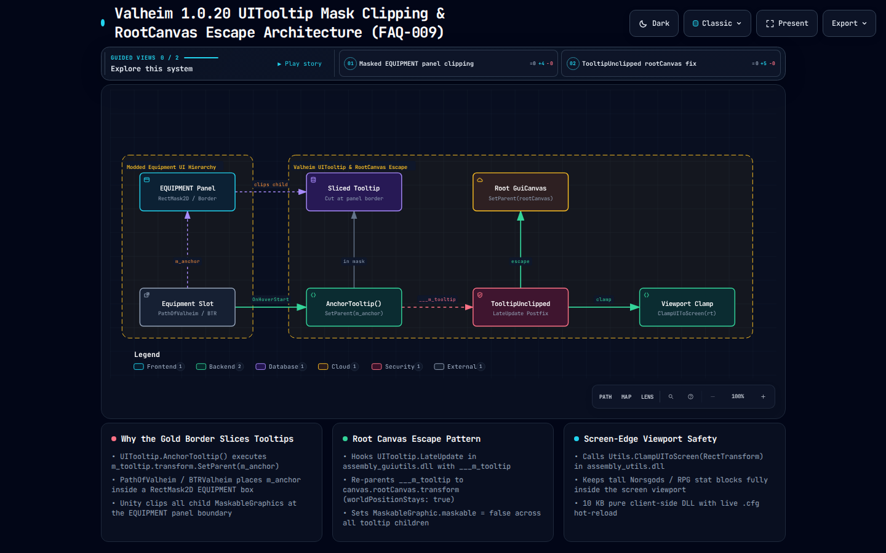

# TooltipUnclipped (Valheim `1.0.20`)

> **Fixes Inventory & Equipment Tooltips Getting Sliced Off by `RectMask2D` Panels (`PathOfValheim`, `BTRValheim`, `Norsgods`, Custom UIs).**

[-success.svg)](#)

## ⚡ Overview

In Valheim `1.0.20`, `UITooltip.AnchorTooltip()` (`assembly_guiutils.dll`) executes `UITooltip.m_tooltip.transform.SetParent(UITooltip.m_anchor)`. When hovering items inside custom mod panels (`PathOfValheim` `EQUIPMENT` panel, socket/skill trees, or `ScrollRect` containers) that carry a `RectMask2D` or `Mask`, Unity's UI stencil clipper slices off the bottom and right edges of the tooltip at the panel boundary.

`TooltipUnclipped` runs a lightweight `[HarmonyPatch(typeof(UITooltip), "LateUpdate")]` Postfix that re-parents `m_tooltip` onto `canvas.rootCanvas.transform` (`worldPositionStays: true`), disables `MaskableGraphic.maskable` on all child images/text, and clamps the tooltip cleanly to the screen bounds via `Utils.ClampUIToScreen`.

- 📖 **Full Bytecode Deep Dive:** [FAQ-009: Why Do Inventory Tooltips Get Sliced Off Along the Equipment Panel Border?](../../docs/faq/FAQ-009-tooltip-cutout-overflow-uitooltip-fix.md)
- 🌐 **Interactive Archify System Map:** [`tooltip-unclipped.architecture.html`](../../docs/tooltip-unclipped.architecture.html)
- 📥 **Pre-Compiled Binary:** [`bin/Release/TooltipUnclipped.dll`](./bin/Release/TooltipUnclipped.dll)
- 🎓 **Learn How It Was Built:** [Valheim 1.0 Modding 101 Workbench](https://delightful-sand-0451e171e.1.azurestaticapps.net/)

## 🛠️ Features & Configuration (`com.deepnorthtesting.tooltipunclipped.cfg`)

- **`EnableMod`** (`true`): Master switch with live `.cfg` hot-reload.
- **`ClampToScreen`** (`true`): Invokes `Utils.ClampUIToScreen(RectTransform)` after lifting the tooltip to `rootCanvas`.
